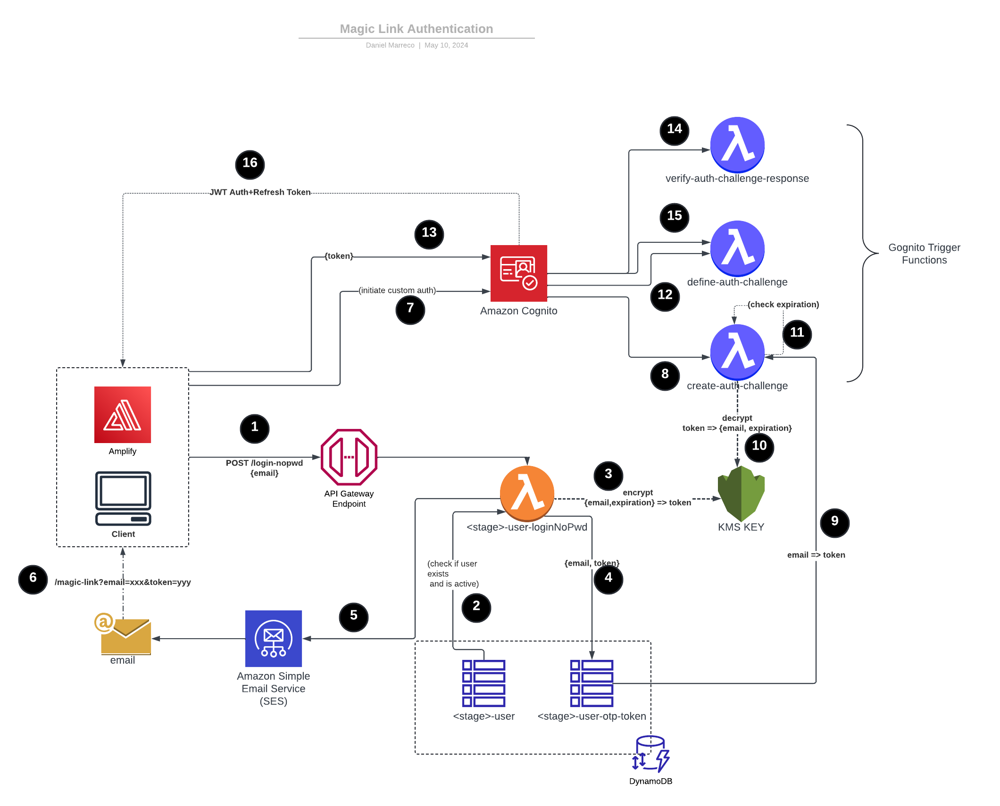

# magic-link-auth

Passwordless login for AWS: the user types an email, gets a time-limited link, and clicking it signs them in through Amazon Cognito custom auth. Standalone extraction of the HomeCloud **Magic Link Authentication** flow.



In short (numbers refer to the diagram):
1. **1–6 – request the link:** the client calls `POST /login-nopwd`; the Lambda checks the user exists and is active, encrypts `{email, expiration}` with KMS, stores the token in DynamoDB and sends the link via SES.
2. **7–16 – sign in:** the client starts Cognito custom auth and sends back the token; the three Cognito trigger Lambdas (define, create, verify) validate it and Cognito returns the JWT and refresh token.

Flow: `POST /login-nopwd {email}` → `loginNoPwd` Lambda checks the user (`<stage>-user`), encrypts `{email, expiration, rnd}` with KMS, stores the token in `<stage>-user-otp-token`, and emails `/magic-link?token=…&email=…` via SES. The client then starts Cognito custom auth; the `define/create/verify-auth-challenge` triggers validate the token (KMS decrypt + email + expiration check) and issue JWTs.

## Layout
- `src/handlers/` – `login-no-pwd`, `define-auth-challenge`, `create-auth-challenge`, `verify-auth-challenge-response`
- `src/adapters/` – minimal KMS/SES/DynamoDB/logger/Result helpers (inlined from the monorepo libs)
- `src/email/` – magic link email template
- `serverless.yml`, `sls-functions.yml`, `sls-resources.yml` – Serverless Framework v3 config (functions, API Gateway route, DynamoDB tables, KMS key, Cognito pool + triggers)
- `test/unit/` – jest + aws-sdk-client-mock

## Commands
```bash
npm install
npx tsc --noEmit
npm test
npx serverless package --stage dev --param="frontendBaseUrl=https://app.example.com"
npx serverless deploy --stage dev --param="frontendBaseUrl=https://app.example.com"
```

## Notes
- As in the original code, token decryption/expiry check happens in `verify-auth-challenge-response` (the diagram draws it at `create-auth-challenge`).
- Cognito pool is trimmed to custom auth only (no pre-signup/post-confirmation/custom-message triggers). Tables, KMS key and user pool use `DeletionPolicy: Delete` for standalone use. Bundling is esbuild via `serverless-esbuild` (no Docker); the Cognito invoke permissions use a `userpool/*` source ARN to avoid a circular dependency with the pool's `LambdaConfig`.
- User lookup keeps the single-table layout: `USEREMAIL#<email>` → `userId`, then `USER#<id>` (needs `email`, `status`).
- The email template still has the HomeCloud logo/sender (`no-reply@gethomecloud.com`) hardcoded.
